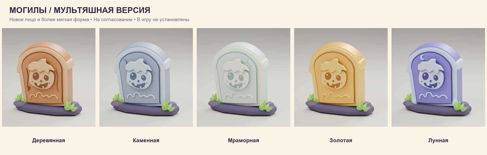

# Мультяшные могилы V3

Пять отдельных 3D-моделей по референсу: приземистая округлая стела с небольшим наклоном, лицо с крупными глазами и улыбкой, каменное основание и трава. Это версия с переработанным лицом.



## Модели

| Тип | GLB | Треугольники |
| --- | --- | ---: |
| Деревянная | [Grave_Wooden.glb](models/Grave_Wooden.glb) | 15 248 |
| Каменная | [Grave_Stone.glb](models/Grave_Stone.glb) | 14 196 |
| Мраморная | [Grave_Marble.glb](models/Grave_Marble.glb) | 14 452 |
| Золотая | [Grave_Golden.glb](models/Grave_Golden.glb) | 14 164 |
| Лунная | [Grave_Lunar.glb](models/Grave_Lunar.glb) | 15 600 |

- [Исходник Blender](models/Graves_Reference_V3.blend): все пять моделей в отдельных коллекциях, расположенных в ряд; также содержит свет, камеру и пол для рендеров.
- Каждый GLB содержит только одну могилу с материалами, основанием и травой, без освещения, камеры и пола. Внешние текстуры не требуются.
- Размеры каждой модели в системе координат Blender: примерно 2,646 × 1,229 × 2,635 единицы (X × Y × Z), нижняя точка Z = 0. В GLB используется стандартная ось Y вверх. Масштаб для Roblox необходимо выбирать при отдельном импорте.
- Геометрия статическая, без скелета и анимаций. Детали доступны отдельными mesh-объектами.
- [Каталог](models/catalog.json) содержит точные границы, количество объектов и треугольников.

## Превью

- [Новая форма и лицо крупным планом](previews/new_design.jpg)
- [Золотая с трёх сторон](previews/golden_views.jpg)
- В `previews/` также есть отдельный рендер каждого типа.

## Пересборка и проверка

Сборка выполнена в Blender 5.2.3. Из корня репозитория:

```sh
blender -b --factory-startup --python art/graves-reference-v3/build.py
python3 -m pip install -r art/graves-reference-v3/requirements.txt
python3 art/graves-reference-v3/package_review.py
```

Скрипт упаковки собирает листы просмотра, проверяет структуру GLB, конечность координат, диапазоны индексов и соответствие числа треугольников каталогу. Результат записывается в `validation.json`. ZIP для передачи создаётся локально и не хранится в Git, поскольку дублирует исходные файлы.

Для подписей на превью скрипт использует Arial из macOS, затем системные шрифты Linux/Windows или шрифт Pillow.

## Подключение к игре

Набор хранится как отдельные арт-ассеты. Он не подключён к Rojo-проектам или игровой библиотеке моделей; плейс, игровые скрипты и действующие могилы не изменены. Импорт и установка в игру — отдельный шаг.
