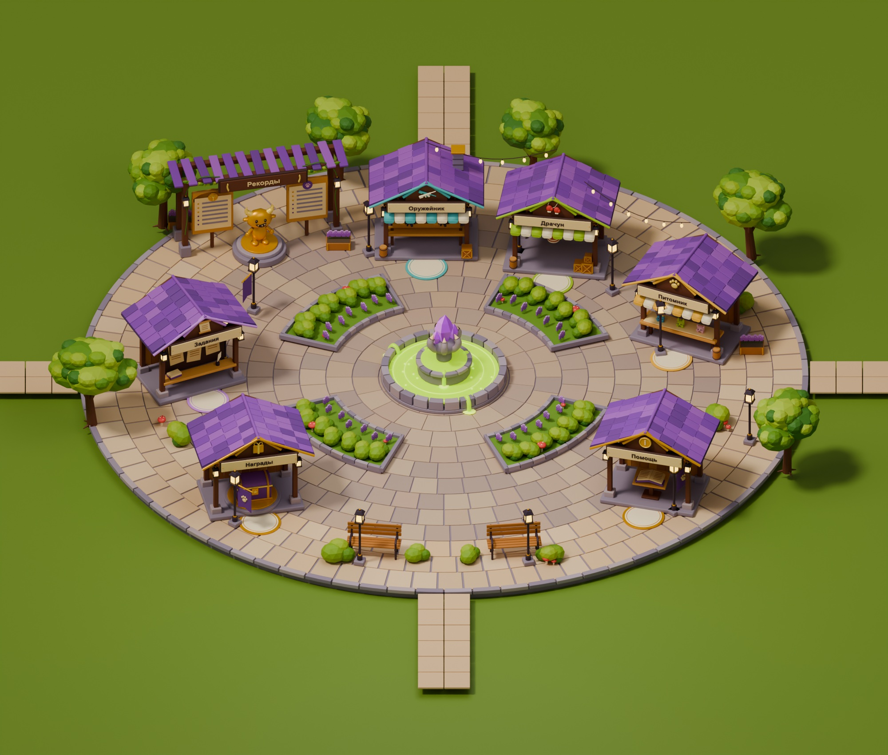

# Центральная площадь — набор по референсу V1

Отдельные 3D-ассеты для согласования будущей замены центральной площади. Набор создан в Blender по приложенному изображению: деревянные павильоны с фиолетовой черепицей, цветные навесы, вывески, фонтан со слизью и кристаллом, пергола рекордов и декор.



## Файлы

- [Plaza_Assembly.blend](models/Plaza_Assembly.blend) — площадь в сборе, с камерой, светом и газоном для просмотра.
- [Plaza_Kit.blend](models/Plaza_Kit.blend) — библиотека отдельных моделей, расставленных в ряд по сетке.
- [Plaza_Assembly.glb](models/Plaza_Assembly.glb) — собранная площадь без обзорного освещения и фонового газона; 64 экземпляра объектов.
- Каждый из 21 ассета также экспортирован отдельным GLB с собственным корневым узлом, дочерними мешами и точками привязки.
- [catalog.json](models/catalog.json) — размеры, число треугольников, группы мешей, точки привязки, примерные коллайдеры и схема размещения объектов.
- [validation.json](validation.json) — проверка фактических GLB, контрольные суммы и проверка полноты сборки.
- [Plaza_Reference_V1_Review.zip](Plaza_Reference_V1_Review.zip) — весь набор одним архивом для скачивания.

## Состав набора

| Файл GLB | Объект | Треугольники | Меши |
| --- | --- | ---: | ---: |
| [Pavilion_Weapons](models/Pavilion_Weapons.glb) | Оружейник | 30,456 | 10 |
| [Pavilion_Brawler](models/Pavilion_Brawler.glb) | Драчун | 25,520 | 10 |
| [Pavilion_Pets](models/Pavilion_Pets.glb) | Питомник | 24,288 | 10 |
| [Pavilion_Quests](models/Pavilion_Quests.glb) | Задания | 24,400 | 9 |
| [Pavilion_Rewards](models/Pavilion_Rewards.glb) | Награды | 23,576 | 10 |
| [Pavilion_Help](models/Pavilion_Help.glb) | Помощь | 21,760 | 9 |
| [Reward_Chest](models/Reward_Chest.glb) | Сундук наград | 1,772 | 3 |
| [Champion_ImpStatue](models/Champion_ImpStatue.glb) | Золотой чемпион | 4,420 | 2 |
| [Records_Pergola](models/Records_Pergola.glb) | Пергола рекордов | 14,100 | 9 |
| [Slime_Fountain](models/Slime_Fountain.glb) | Слизневый фонтан с кристаллом | 15,282 | 4 |
| [Bench](models/Bench.glb) | Лавка | 3,204 | 2 |
| [Lantern](models/Lantern.glb) | Фонарь | 2,116 | 3 |
| [Lantern_Banner](models/Lantern_Banner.glb) | Фонарь со знаменем | 3,216 | 5 |
| [Shrub_Cluster](models/Shrub_Cluster.glb) | Кусты | 320 | 1 |
| [Mushroom_Cluster](models/Mushroom_Cluster.glb) | Грибы | 832 | 1 |
| [Planter_Box](models/Planter_Box.glb) | Ящик с лавандой | 6,912 | 2 |
| [Flowerbed_Curved](models/Flowerbed_Curved.glb) | Дуговая клумба | 18,348 | 4 |
| [Tree_Oak](models/Tree_Oak.glb) | Мультяшный дуб | 7,284 | 2 |
| [StringLights_12](models/StringLights_12.glb) | Гирлянда 12 студов | 2,280 | 2 |
| [Plaza_Paving](models/Plaza_Paving.glb) | Круглое мощение, радиус 41 | 89,060 | 10 |
| [Path_Segment_6](models/Path_Segment_6.glb) | Дорожка 6 × 6 | 432 | 1 |

## Согласование

- [Павильоны крупным планом](previews/pavilions.jpg)
- [Фонтан, рекорды и статуя](previews/hero_objects.jpg)
- [Декор и озеленение](previews/decor.jpg)
- [Общий вид с другого ракурса](previews/Plaza_day.jpg)

Персонажи игроков и фермы за пределами площади не включены. Питомцы на прилавке и золотой бес — статические декоративные модели.

## Подготовка к будущей замене

Модели пока не подключены к игре. Файлы `src/`, `assets/runtime/`, `place/` и конфигурация Rojo не изменялись.

| Назначение в текущей игре | Новый ассет |
| --- | --- |
| `V3_StallWeapons` | `Pavilion_Weapons` |
| `V3_StallBrawler` | `Pavilion_Brawler` |
| `V3_StallPets` | `Pavilion_Pets` |
| `V3_QuestBoard` для заданий | `Pavilion_Quests` |
| `V3_QuestBoard` для помощи | `Pavilion_Help` |
| `V3_RewardChest` | `Pavilion_Rewards` или отдельный `Reward_Chest` |
| Таблица рекордов и статуя чемпиона | `Records_Pergola` и `Champion_ImpStatue` |
| `W_Fountain` | `Slime_Fountain` |

### Координаты и структура

- Единицы авторской сцены соответствуют студу; ось Z вверх, фасад смотрит вдоль -Y. GLB использует стандартную ось Y вверх. При отдельном импорте в Roblox необходимо проверить итоговые масштаб и поворот.
- Радиус мощения — 41 студ, плюс наружный бордюр до 41,45. Поверхность мощения находится около Z = 0. Основание уходит вниз; объекты сборки подняты на 0,10 над номинальным уровнем.
- Модели экспортированы у своего локального начала координат. Дуговая клумба имеет начало в центре площади: её удобно поворачивать вокруг центра на 45, 135, 225 и 315 градусов. Гирлянда имеет длину 12 студов; точки `Left` и `Right` находятся на высоте 10.
- Дочерние меши объединены по назначению: `Structure`, `Roof`, `Awning`, `SignFrame`, `SignText`, `Emblem`, `Glow`, `DisplayProps` и др. Черепицы и мелкие детали не требуют отдельных игровых объектов.
- Крышка сундука находится в `ChestLid`, петля указана точкой `LidPivot` в отдельной модели сундука. Это геометрия для будущей анимации; готовой анимации нет.
- Тексты русских вывесок — отдельные меши `SignText`. Их можно заменить локализуемыми табличками при подключении к игре. Строки таблиц рекордов являются декоративными образцами, реальные данные игроков не запекались.
- У статуи отдельные `Pedestal` и `Figure`, а также `FigureBase`: декоративного беса можно заменить фигурой лидера.
- Светящиеся детали имеют отдельный меш `Glow`; реальные источники света и игровые эффекты добавляются на этапе интеграции. В GLB нет камер, ламп или внешних текстур; цвета заданы материалами.
- Мощение разделено на восемь групп секторов, основание и бордюр. Коллайдеры в каталоге являются только метаданными, игровых коллизий в наборе нет.

## Пересборка

Подготовлено с Blender 5.2.3 и Python 3. Из корня репозитория:

```sh
blender -b --factory-startup --python art/plaza-reference-v1/build.py
python3 -m pip install -r art/plaza-reference-v1/requirements.txt
python3 art/plaza-reference-v1/package_review.py
```

Сборка создаёт GLB, Blender-файлы и рендеры. Упаковка проверяет геометрию и все 64 экземпляра в сборке, создаёт листы согласования и `Plaza_Reference_V1_Review.zip`. Архив также включён в репозиторий для скачивания всего набора одним файлом. Для русских подписей используются доступные шрифты macOS, Linux или Windows.
